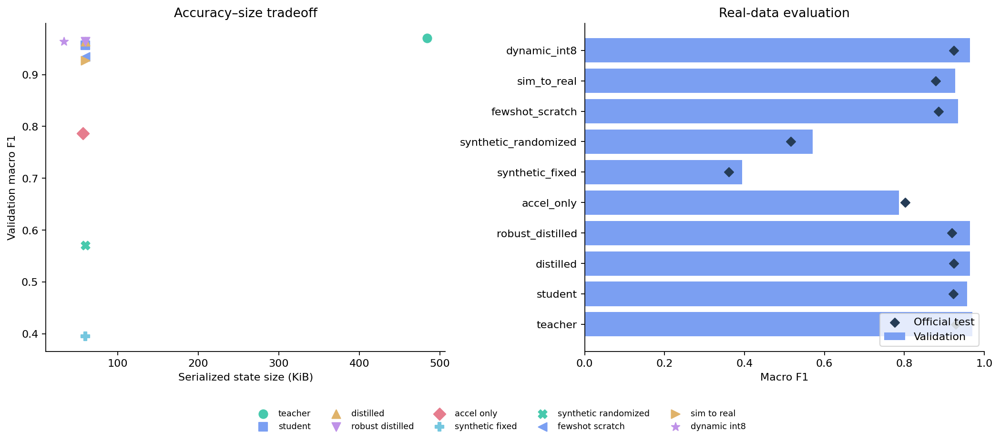

# Edge Agent Lab

**Three research engineering projects connecting sensor data, efficient on-device models, and tool-using AI systems.**

This repository asks a concrete question: how do you turn imperfect sensor data into a small deployable model, and make the engineering decisions reproducible enough for an agent to help?

The projects share real smartphone accelerometer and gyroscope recordings, a versioned data pipeline, and one evaluation protocol. Each has its own runnable entry point and engineering focus.

| Project | What it builds | Main evidence |
|---|---|---|
| [01 · Edge Sense](projects/01-edge-sense/README.md) | Multistream activity recognition, distillation, partial INT8, Core ML, simulation-to-real transfer | Subject-held-out accuracy, calibration, robustness, package size, measured latency |
| [02 · Data Steward](projects/02-data-steward/README.md) | A data engineering agent with retrieval, typed tools, SQLite provenance, and optional local semantic intent routing | Golden task evaluation, retrieval relevance, incident audits, complete tool traces |
| [03 · Edge Pilot](projects/03-edge-pilot/README.md) | An adaptive planner–runner–critic workflow for constrained model selection and shadow monitoring | Hard deployment gates, Pareto frontier, budget accounting, explicit infeasibility |

## Explore the completed study

- [Measured results and limitations](reports/RESULTS.md)
- [Offline experiment dashboard](reports/index.html) — open locally, or serve the repository with `python -m http.server 8000` and visit `/reports/`.
- [Machine-readable evidence](reports/results.json)
- [Architecture](docs/ARCHITECTURE.md), [experiment protocol](docs/EXPERIMENTS.md), and [role relevance](docs/ROLE_ALIGNMENT.md)



## Quick start

Python **3.11 or 3.12** is required. The dependency baseline supports the development machine's macOS 13.4; PyTorch 2.2.2 is intentionally pinned. The CPU path also runs on Linux. Core ML requires macOS.

```bash
uv venv --python 3.12 .venv
source .venv/bin/activate
uv pip install -e '.[dev]'
edge-lab prepare
edge-lab train --seeds 7 --epochs 40 --compact
edge-lab steward-eval
edge-lab pilot
edge-lab evaluate
edge-lab report
pytest -q
```

`prepare` downloads approximately 58 MB from UCI, checks a pinned SHA256, and creates subject-disjoint train/validation/test arrays. Model training requires no paid services or credentials. The compact run trains four floating models plus an INT8 variant. Use the full study for simulator and modality ablations:

```bash
python scripts/train_study.py --config configs/overnight.yaml
```

Completed candidate directories are reused. `scripts/run_all.py` orchestrates training, agent evaluation, selection, held-out evaluation, optional Core ML export, and reports with a durable stage ledger. See [reproduction instructions](docs/REPRODUCING.md).

## Run each project

```bash
# 01: real-data learning + controlled simulation-to-real comparisons
edge-lab train --seeds 7 23 42 --epochs 40

# 02: evidence-based tool execution, no LLM required
edge-lab steward "Investigate a missing gyroscope sensor outage"
edge-lab steward-eval

# Optional local model for semantic task routing; approximately 1.1 GB download
uv pip install -e '.[local-llm]'
python scripts/evaluate_intent_router.py
edge-lab steward --planner local-intent "Investigate a missing gyroscope sensor"

# 03: validation-only constrained model selection and synthetic outage replay
edge-lab pilot --objective configs/pilot.json
edge-lab search --objective configs/search.json

# Apple: export + real local CPU runtime comparison
uv pip install -e '.[apple]'
edge-lab export-apple
python scripts/run_native.py

# Independent measured-data transfer probe (additional 42 MB dataset)
edge-lab probe
edge-lab baselines
```

The deterministic planner is deliberately labeled as a policy baseline.
A separate policy-fixed LLM ablation is available with
`python scripts/evaluate_policy_guarded.py`; it measures model realization cost
while the policy controls tool choices and arguments. The optional Qwen planner uses a local quantized GGUF, grammar-constrained actions, and the same tool executor. Its results are evaluated separately; no hosted model or hidden API key is required.

## Research discipline

- Official test subjects never enter training, preprocessing, or candidate ranking.
- Validation holds out four subjects from the official training partition. Adjacent overlapping windows never cross subject partitions.
- Every model embeds its own training-only normalization for consistent deployment.
- Real recordings, procedural simulated motion, and synthetic corruptions of recordings are labeled separately.
- Distillation is compared against the same student architecture trained without a teacher.
- Simulation transfer compares equal real-label budgets, including a scratch baseline.
- Dynamic INT8 uses real integer Linear kernels; convolutions remain floating point.
- Core ML export, runtime measurement, and hardware placement are distinct claims.
- A controller finding no feasible candidate is a valid outcome.

## Repository map

```text
src/edge_agent_lab/      Shared typed data, models, agents, metrics, CLI, reports
projects/               Three project guides and native deployment example
configs/                Full-study configuration, deployment objective, golden tasks
scripts/                Reproducible study and local-model evaluation entry points
tests/                  Data leakage, drift, injection boundaries, training, selection
reports/                Committed measured summaries, figures, offline dashboard
docs/                   Design, protocol, model/data cards, sources, reproduction
.github/workflows/      CPU checks on pull requests
```

Large data, local language-model weights, SQLite databases, and trained checkpoints stay in ignored `data/` and `artifacts/` directories. The committed reports contain the observed evidence without requiring those large files.

## Attribution

UCI HAR: Reyes-Ortiz, Anguita, Ghio, Oneto, and Parra (2013), [DOI: 10.24432/C54S4K](https://doi.org/10.24432/C54S4K), **CC BY 4.0**. The project uses the published preprocessed windows rather than claiming raw sensor collection. See [sources and licenses](docs/SOURCES.md).

Repository code is MIT licensed. Dataset and optional model licenses are separate. This is a portfolio research implementation; production readiness and state-of-the-art performance are not claimed.
