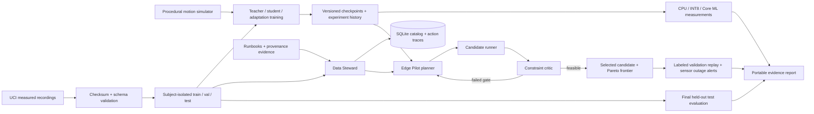

# System architecture

## Ownership boundaries

`data.py` owns source fetching, archive verification, channel layout, split isolation,
and signal simulation. It never trains a model. `models.py` embeds preprocessing
and provides a restricted checkpoint loader, including a primitive encoding for
quantized weights compatible with PyTorch 2.2.

`training.py` owns experiments and validation-only checkpoint selection. Final test
evaluation is a separate function and command. `metrics.py` centralizes F1,
calibration, subject-bootstrap confidence intervals, and batch-one timing.

`steward.py` contains the typed action contract, retrieval, audits, SQLite catalog,
and agent loop. The executor permits a fixed tool set. A policy planner, optional
Ollama planner, and optional in-process llama.cpp planner share the same contract.
No planner can submit arbitrary code or SQL. LLM output is data parsed by Pydantic.

`pilot.py` is an adaptive controller with explicit planner, runner, and critic
roles. These are workflow actors, not a claim of independent intelligent agents.
Its decisions use validation measurements only. It prioritizes robust candidates
following gate failures and stops at a trial or wall-clock budget boundary.

`apple.py` performs conversion, weight compression, parity checks, and local Core
ML runtime measurement. `reporting.py` publishes portable evidence artifacts.

## Data contracts

- Signals: `float32[N, 9, 128]`, 50 Hz, windows of 2.56 seconds.
- Channel order: body acceleration xyz, body gyroscope xyz, total acceleration xyz.
- Labels: zero-based six-class activity labels; original UCI labels are one-based.
- Dataset identity: source archive SHA256 plus derived file SHA256 values.
- Model identity: config, embedded normalization, state, checkpoint SHA256.
- Agent event: run ID, step, validated action, observation, tool duration.
- Selection: objective, measured candidates, critic margins, winner or infeasibility.

## Failure behavior

Downloads use partial files and dataset preparation uses an interprocess lock.
JSON writes are atomic. A source hash mismatch stops ingestion. Invalid action
schemas cannot reach the executor. Tool failures produce incomplete durable runs.
Training writes epoch histories and completed candidate checkpoints. A rerun reuses
completed candidates; an interrupted candidate restarts, rather than pretending
optimizer state was restored. Wall-clock budgets are checked between candidate
evaluations, so one in-flight evaluation may exceed the remaining budget.
