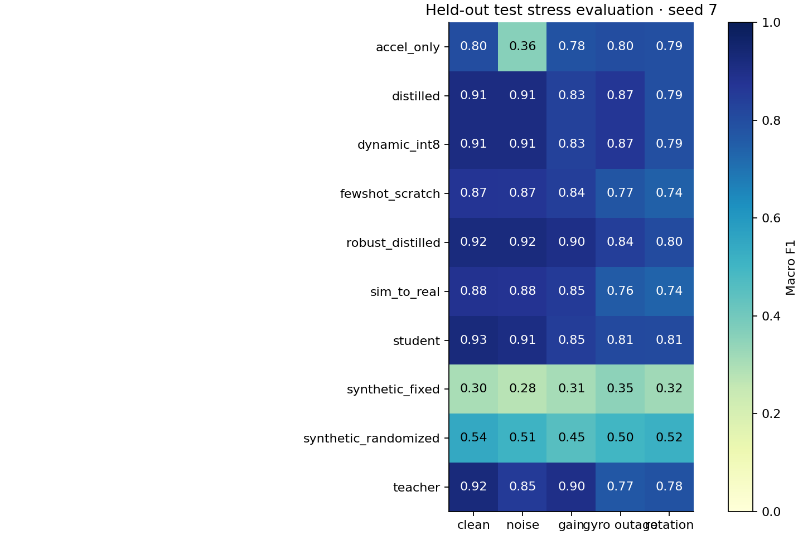
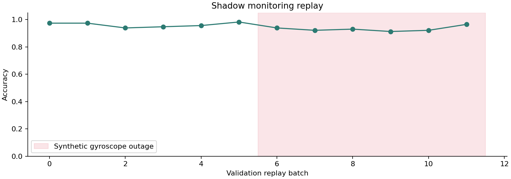

# Measured experiment results

Generated from saved artifacts. Validation selects models; official held-out test
results are reporting only. All figures and tables use observed measurements.

## Edge model study

| Candidate | Seeds | Val F1 | Test F1 | p95 ms | KiB | Outage F1 |
|---|---:|---:|---:|---:|---:|---:|
| teacher | 3 | 0.9703 ± 0.0014 | 0.9280 ± 0.0034 | 0.889 | 484.2 | 0.7639 |
| student | 3 | 0.9568 ± 0.0059 | 0.9222 ± 0.0077 | 0.106 | 59.8 | 0.8163 |
| distilled | 3 | 0.9643 ± 0.0055 | 0.9234 ± 0.0083 | 0.199 | 59.8 | 0.8715 |
| robust_distilled | 3 | 0.9638 ± 0.0055 | 0.9194 ± 0.0014 | 0.121 | 59.8 | 0.8503 |
| accel_only | 3 | 0.7863 ± 0.0043 | 0.8021 ± 0.0048 | 0.117 | 57.0 | 0.8021 |
| synthetic_fixed | 3 | 0.3947 ± 0.0542 | 0.3610 ± 0.0538 | 0.110 | 59.8 | 0.3399 |
| synthetic_randomized | 3 | 0.5708 ± 0.0512 | 0.5161 ± 0.0521 | 0.112 | 59.8 | 0.4252 |
| fewshot_scratch | 3 | 0.9348 ± 0.0056 | 0.8853 ± 0.0092 | 0.120 | 59.8 | 0.8019 |
| sim_to_real | 3 | 0.9273 ± 0.0262 | 0.8780 ± 0.0169 | 0.116 | 59.8 | 0.7873 |
| dynamic_int8 | 3 | 0.9641 ± 0.0051 | 0.9237 ± 0.0086 | 0.194 | 33.1 | 0.8716 |

± is sample standard deviation across training seeds. Per-model subject-bootstrap
accuracy intervals are in `results.json`. Storage is serialized state, not peak RAM.
CPU p95 is the median of per-run p95 values. Development timing had concurrent load.

The supervised student state is **8.10× smaller** than the teacher state.
Simulation pretraining changes equal-label-budget test macro F1 by **-0.73
percentage points** relative to training the same 480-window budget from scratch.
This is a descriptive seed average, not a significance claim.

## Classical references

Fixed model parameters; inference timing includes statistical feature extraction.

| Model | Val F1 | Test F1 | p95 ms |
|---|---:|---:|---:|
| statistical_logistic | 0.9030 | 0.8986 | 0.324 |
| statistical_boosting | 0.9077 | 0.8844 | 4.024 |

## Data stewardship agents

Strict pass requires completion, relevant retrieval, correct incident arguments, and
no unnecessary simulation tools. A completed but incorrect workflow fails.

| System | Cases | Strict success | Retrieval hit@3 | Mean task seconds |
|---|---:|---:|---:|---:|
| Policy | 8 | 1.000 | 1.000 | 0.15 |
| Qwen 1.5B schema only | 8 | 0.000 | 0.000 | 19.65 |
| Qwen 1.5B workflow guards | 8 | 0.000 | 0.625 | 31.15 |
| Qwen 7B workflow guards | 8 | 0.125 | 0.250 | 40.33 |
| Qwen 1.5B grounded per-tool schema | 8 | 0.125 | 1.000 | 13.36 |
| Qwen 1.5B intent + typed workflow | 8 | 1.000 | 1.000 | 0.71 |
| Policy-fixed Qwen realization | 8 | 1.000 | 1.000 | 37.63 |

The corpus and golden suite are small curated regressions. Schema/workflow guards
do not guarantee semantic correctness. Policy-fixed realization removes model decision
authority: policy chooses the tool and arguments; the LLM only supplies a reason.
Its success must not be attributed to autonomous planning. Inspect failures in JSON.
Intent routing infers task intent before retrieval, then executes
typed steps, separating model intent from execution authority.

## Constraint-aware model selection

### Saved-candidate pilot

Status: **selected**. Winner: **dynamic_int8**. Trials: 8.

Validation F1: 0.9602; outage F1: 0.9359; p95: 0.168 ms; state: 33,934 bytes.

All hard gates use validation measurements. Test metrics are excluded.
Objectives, critic margins, trained proposals, and Pareto frontier are in JSON.

### On-demand training search

Status: **selected**. Winner: **width-6-base**. Trials: 3.

Validation F1: 0.9576; outage F1: 0.9320; p95: 0.087 ms; state: 21,402 bytes.

All hard gates use validation measurements. Test metrics are excluded.
Objectives, critic margins, trained proposals, and Pareto frontier are in JSON.

### Search-model held-out evaluation

Single seed; test reporting follows validation selection.

| Candidate | Test macro F1 | Test gyro-outage F1 |
|---|---:|---:|
| trained/width-4-robust | 0.9065 | 0.8370 |
| trained/width-6-base | 0.9059 | 0.8337 |
| trained/width-6-robust | 0.9046 | 0.8312 |

Actual 1,024-byte storage-gate probe: **no_feasible_candidate**; no fallback was promoted.

## Core ML deployment

CPU_ONLY timings include Python API overhead. No ANE placement or energy claim.

| Variant | Package bytes | Runtime | p95 ms | PyTorch top-1 agreement |
|---|---:|---|---:|---:|
| float32 | 68,176 | measured | 0.057 | 1.0000 |
| weight_int8 | 29,417 | measured | 0.059 | 1.0000 |

Native Swift parity passed: **True** on one saved input. Maximum probability difference: 5.79e-08.
Direct swiftc compilation and Core ML inference were executed locally.

### Search-selected model deployment

The newly trained candidate is exported independently of the original student.

| Variant | Package bytes | p95 ms | PyTorch agreement |
|---|---:|---:|---:|
| float32 | 28,951 | 0.053 | 1.0000 |
| weight_int8 | 19,381 | 0.053 | 1.0000 |

Native Swift parity passed: **True**; maximum probability difference: 1.01e-08 on the saved example.

## Independent real-data transfer probe

HAR70+: 15,205 retained windows from 18 independent subjects.
Population, placement, preprocessing, and modalities differ. Gyro is absent.
Both predefined orientations are reported; these labels do not select an orientation
or model. This is a descriptive mismatch probe, not a comparable HAR70+ benchmark.

| Candidate | Orientation | External macro F1 |
|---|---|---:|
| teacher | as_recorded | 0.0313 |
| teacher | fixed_180_degree_y_rotation | 0.2908 |
| student | as_recorded | 0.0313 |
| student | fixed_180_degree_y_rotation | 0.3244 |
| distilled | as_recorded | 0.0313 |
| distilled | fixed_180_degree_y_rotation | 0.3406 |
| robust_distilled | as_recorded | 0.0313 |
| robust_distilled | fixed_180_degree_y_rotation | 0.3157 |
| dynamic_int8 | as_recorded | 0.0313 |
| dynamic_int8 | fixed_180_degree_y_rotation | 0.3405 |

## Interpretation limits

- Four primary validation subjects and nine official test subjects limit confidence.
- Validation is reused for epoch and candidate selection.
- Synthetic simulation and corruption do not establish new-device generalization.
- Few-shot uses 480 labeled windows from known training subjects.
- Body-acceleration-only removes gravity information as well as the gyroscope.
- Dynamic INT8 quantizes Linear layers only; Core ML compression is weight-only.
- Storage, latency, RAM, energy, and hardware placement are different measurements.
- The agent benchmark is curated and small; it does not prove enterprise readiness.
- Workflow actors are software roles; no independent multi-agent reasoning claim.
- No production deployment, clinical validation, or state-of-the-art claim.
